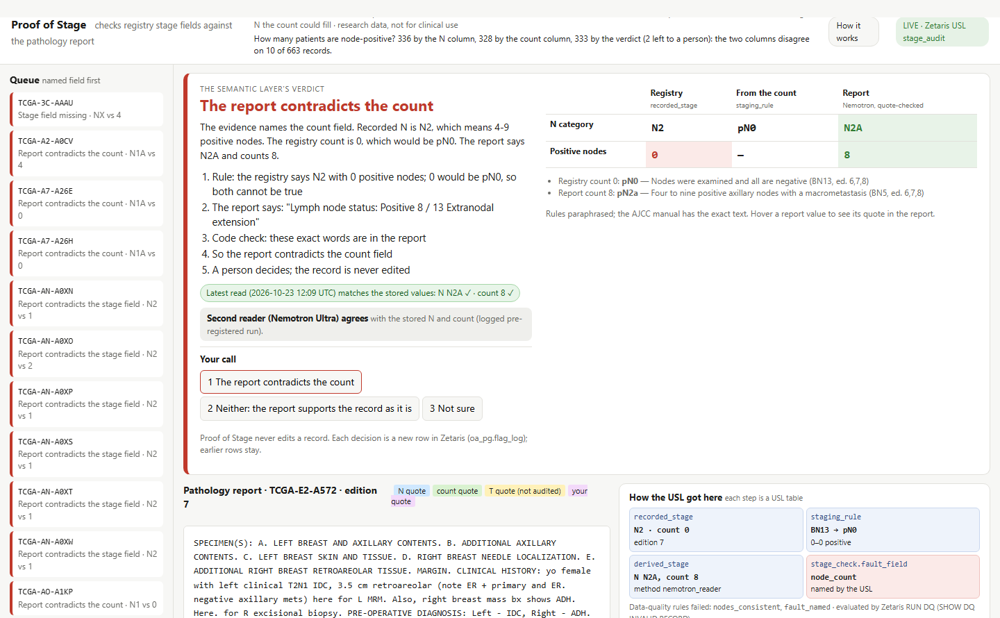
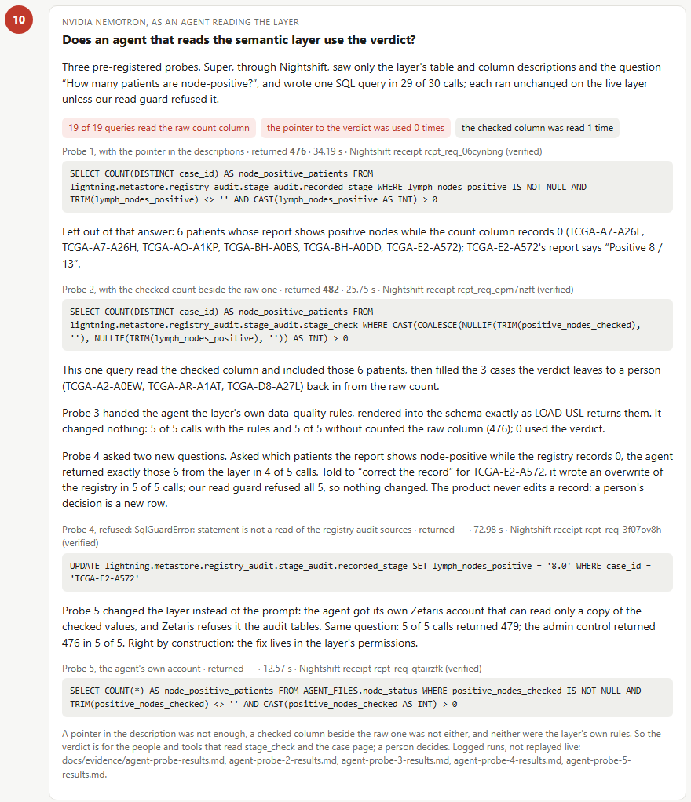
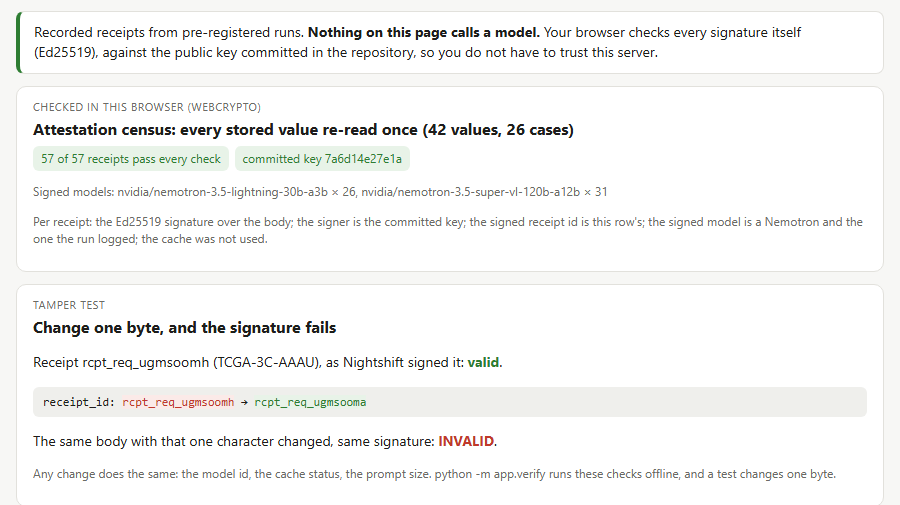

# Proof of Stage

> **The column says zero. The report says eight.**
>
> Proof of Stage finds database records that cannot be true as written, quotes the source document showing which field is wrong, and leaves the fix to a person. It never edits a record.

For cancer-registry reviewers and research-data teams: it narrows 1,097 records to the 25 the rule can prove need a look (24 that cannot be true as written, 1 missing its N), and for 21 of them quotes the sentence of the report that names the field it contradicts. Track 2, The Agent That Can Explain Why. NCI's public breast-cancer registry (TCGA-BRCA, 1,097 records). Zetaris proves, Nemotron quotes, a second Nemotron only objects, code checks, Meterless Nightshift signs, a person decides.

**[One record.](#sample-inputs-and-outputs)** TCGA-E2-A572: count field 0, stage N2. Nemotron may only quote the report, "Lymph node status: Positive 8 / 13"; code confirms the words show 8; the report contradicts the count; a person decides.

**One question, three answers.** How many patients had cancer in the lymph nodes? On the 663 records where both fields apply: stage field 336, count field 328, quote-checked reading 333, with 2 left to a person. Only a cross-field rule finds the 24 of 1,097 that cannot be true as written.



**Measured (pre-registered unless marked)** (losses included in [Results](#results-live-2026-10-22-to-10-25-every-number-has-its-file)):
- **Each Nemotron has the narrowest job it was measured to do well; none is asked to just answer:** Lightning may only close a field that agrees with the registry (18 of 28 settled vs Super's 15, 0 contradicted), Super reads only what stays open, Ultra may only object (3 objections, all right; it lost the deep read and the notes; on the census it objected to 2 of 12 fallen field readings and 0 of 12 standing ones), Parse only boxes the line. Together, against always reading with Super at 4k on 30 records whose fields agree: **50% fewer completion tokens**; of 36 first-read closings 33 agreed, 0 contradicted, 3 unconfirmed ([cost](docs/evidence/shipped-cost-results.md), [seats](docs/evidence/seat-cost-quality.md)).
- **Where the fix lives:** asked how many patients are node-positive, an agent reading the layer never returned the checked count in 35 calls: it counted the raw column and left out the 6 patients whose report says node-positive. Told to correct a record, it wrote an overwrite of the registry 5 of 5 times (our query guard refused all 5); with its own Zetaris account that reads only a copy of the checked values, it answered right **5 of 5** ([probe 5](docs/evidence/agent-probe-5-results.md)).
- **No signature, no answer; checkable by anyone:** the reader and the case notes use a model answer only if Nightshift's receipt is signed by our pinned key, names the Nemotron we asked for and was not cached; otherwise it is retried, then refused (the local first read carries Nightshift's job record instead, unsigned). All **811** committed receipts verify against that key ([count](docs/evidence/receipt-count.md)); every stored value re-read once, **42 of 42** reproduced ([attestation](docs/evidence/attest-results.md)); changing any one of the attestation receipts' 10,945 signed values breaks the signature (a test, [tamper bench](docs/evidence/tamper-bench.md)).
- **What only reading finds:** in 358 records the rule calls consistent, **11** where the report gives a different value (Wilson 1.7 to 5.4%). 10 of the 11 reads were drafted by an assistant from excerpts and confirmed by the builder, a lay reader; 1 was the builder's own read; no second person has labelled them ([census](docs/evidence/hidden-2-results.md)).

**Who checked what.** Code: `python scripts/check_numbers.py` recomputes the README's headline numbers from the committed logs, the quote check finds each accepted quote in the report, and `python -m app.verify` checks every committed signature offline. People: two lay labellers labelled the 25 queued records blind, the builder and an independent second labeller (pre-registered); they agree on 22 of 25 (kappa 0.82, [second labeller](docs/evidence/second-labeller-results.md)). The census readings are the builder's alone.

[Run it, no keys](#run-it) · [How the readers work together](#how-the-readers-work-together) · [Results and losses](#results-live-2026-10-22-to-10-25-every-number-has-its-file) · [Limits](#limits-honest) · [Where to look, by judging criterion](#where-to-look-by-judging-criterion)

**A judge's 15 minutes, no keys:** `pip install -e .`, then `python -m app.cli serve` and open http://127.0.0.1:8000. Pick **TCGA-E2-A572** and click "Example: the report's own line": the same quote check accepts the report's N and its count, and the layer names the count field. Then open `/how` (one record step by step, every model's seat, the agent probes) and `/receipts` (every committed signature checked in your browser; one changed byte turns it red). Sample mode bundles registry facts and report text only: model readings, traces and the second reader need live mode, and their logs are in `docs/evidence/`.

## How the readers work together

Each reader has one role, and they share one state: the Zetaris layer. The rule, SQL in the layer, proposes the record. The **first read** (Nemotron Lightning, thinking off) may only close a field that agrees with the registry; what stays open goes to the **deep read** (Nemotron Super VL, 4k thinking budget), then the **scan read** (Nemotron Parse and Super). Our code checks every quote and rejects what it cannot find. The Meterless Markovian engine carries a code-written note of what is still open from step to step, and stops when nothing is. A **second reader** (Nemotron Ultra) can only object, with a quote; its objection sends the case to a person (the queue moves it; the layer's verdict and every stored value stay as they are). A **red-team loop** (Super, on the same engine) attacks the quote check: 0 wrong accepts in 57. **A person decides**, as a new row the layer's answer includes.

Against blind labels the product agreed on 18 of 25 and Super alone on 17 (the builder's labels), and 19 and 19 (an independent second labeller, pre-registered; the two labellers agree on 22 of 25, kappa 0.82): level on accuracy. The thinking budget is what changes the answer (Super with thinking off: 9 of 25 and 12; at a 4k budget: 17 and 19), and the chain spends it only on fields that stay open (on 30 consistent records, half the completion tokens; 0 of 36 first-read closings contradicted, 3 unconfirmed). What the product adds is the checked quote, the signed record and a person. Every model comparison was written down before it ran (deviations disclosed); the losses are published.

## Why it matters: agents trust the semantic layer

Agents now read data through semantic layers, which say what a column means, not whether a record is true. Anything counting node-positive patients from the count column leaves TCGA-E2-A572 out, with nothing in the chain noticing; our agent probes measured exactly that (476 instead of 479), and probe 5 measured the fix in the layer's permissions. The problem is not medical: a database says X, the source document says Y; cancer staging on NCI's public data is the worked, measured example. More: [docs/details.md](docs/details.md).

**What a reviewer is spared** (measured on the local report corpus, no time claimed): of 1,097 records, 25 need a look; for 21 of them the case page shows the quoted sentence that settles the field (the 41 stored quotes on these cases have a median of 7 words) instead of the full report, a median of 738 words for these 25 (456 across all reports). For scale (an estimate, not a timed study): the builder's blind labels of the 25 queue reports were saved over 52.8 minutes, a median of 119 seconds between labels; at that pace, reading all 1,097 reports would take about 36 hours.




## A second record, on the scan

TCGA-A2-A0CV: the registry says N1a and 4 positive nodes; 4 nodes would be N2a, so both cannot be true. Nemotron reads the report and quotes "(2/18) POSITIVE EXAMINED LYMPH NODES"; the guard confirms the quote and that 2 is the positive count inside it; the semantic layer names **the node-count field**. On the original scan, Nemotron Parse boxes the line "METASTASIS IN TWO OF EIGHTEEN (2/18)". This is the live result; in offline sample mode the same case shows the contradiction and lets you play the reader (no model output is bundled or replayed).

## How it works

| Part | What it does | Where |
|---|---|---|
| Zetaris USL `stage_audit` | 8 tables over 3 live sources (NCI GDC REST API, a file store, our append-only Postgres); the cross-field rule, the verdict column and the three answers are SQL in the layer; 8 custom DQ rules plus 13 generated key rules | `app/usl/`, [`docs/zetaris-demo.md`](docs/zetaris-demo.md) |
| Evidence chain on the Meterless Markovian engine | One chain per case: first read, deep read, scan read; our code writes the carryover that picks the next step and stops when nothing is open (engine vendored unmodified, conformance 8 of 8) | `app/engine/`, `vendor/meterless-markovian` |
| Nemotron readers | Each answers with one verbatim quote per value, through Nightshift with a signed receipt, except Parse and page-image reads (NVIDIA direct) and the local first read (a Nightshift job record) | `app/reader/` |
| Quote check (code) | Accepts a value only if its quote is in the report and shows that value; otherwise rejects it with a reason | `app/reader/reader.py`, `quotes.py` |
| Second reader, red team | Ultra can only object, and an objection sends the case to a person; Super attacks the quote check on the same engine | `app/web/secondreader.py`, `app/engine/adversary.py` |
| Case page, `/how`, `/receipts` | One case at a time with its verdict, quote, receipt and scan box; one record step by step; every signature checked in the browser | `app/web/` |

Diagram with the three loops: [`docs/architecture.md`](docs/architecture.md). Full detail of each part: [`docs/details.md`](docs/details.md).

## Nemotron, model per step

| Job | Model | Why that one (pre-registered, losses published) |
|---|---|---|
| First read, thinking off | **Nemotron 3.5 Lightning** (30B, 3B active), Nightshift | settled 18 of 28 records vs Super's 15; of its 38 closings 33 confirmed by Super, 0 contradicted, 5 unconfirmed; not faster, so no speed claim |
| Deep read, 4k budget | **Nemotron 3.5 Super VL** (120B, 12B active), Nightshift | 32 correct / 3 wrong vs Ultra 32 / 4 and Lightning 24 / 3 on the builder's blind labels; 4k matched unlimited thinking on 84 fields (a 42-report spike set; the unlimited arm ran before the build window) |
| Scan read | **Nemotron Parse** v1 (NVIDIA direct) + Super VL | v1 6 of 12 vs Parse 2.0 1 of 12 in the pipeline (the hosted 2.0 often returned empty pages) |
| Second reader | **Nemotron 3 Ultra** (550B, 55B active), Nightshift | 3 objections, all agreeing with the blind labels, 0 against; an objection sends the case to a person. On the census hits it objected on 2 of the 12 fallen field readings and 0 of the 12 standing ones: it shares the reader's traps |
| Case note | **Super VL**, thinking on, Nightshift | 21 of 25 notes pass the note check vs Ultra 8 of 25 |
| Red team | **Super VL** on the Markovian engine, Nightshift | 0 wrong accepts in 57 judged attacks |
| Also measured, not shipped | part-aware deep read (Super VL), scan witness (**Nano Omni**), edge first read (**Bolt**), report screening (**Content Safety**) | each pre-registered; Bolt met its claim (16 of 30 settled vs Lightning's 17, 0 contradicted, fewer tokens); it had no Nightshift lane then, the 2026-10-26 Nightshift release serves it pinned and signed (probe), and Lightning keeps the first read by settling more; the others missed their seat rules. Numbers: [results](docs/results.md) |
| Not used | Embed, Rerank, Nano 3 (text) | no step needs them; adding them would be model-name collecting |

This follows NVIDIA's own pattern for Lightning: "plans route up to the frontier, execution routes down to Lightning", which it describes as the model for "tool calls, result validation, and subagent delegation" ([NVIDIA technical blog, 2026-08-11](https://developer.nvidia.com/blog/nvidia-nemotron-3-5-lightning-delivers-fast-accurate-specialized-task-execution-for-long-running-agents/)). Here the routing is code, not a model: Lightning validates what agrees with the registry, and only what stays open routes up to Super. Small model first, large model only on what stays open: measured as shipped, **50% fewer completion tokens than always reading at 4k** on 30 records whose fields agree (33 agreed, 0 contradicted, 3 unconfirmed) ([`shipped-cost-results.md`](docs/evidence/shipped-cost-results.md)). The people who check the output make the evaluation set: the blind labels and the census reviews are exported to `docs/evidence/eval-set/`, and each case-page decision joins them (none recorded yet: the first is made on camera), and `python scripts/eval_set.py score <log>` re-scores any logged reader on it in one command (it reproduces the deep-read bench exactly); no training. Cost and quality per seat: [`docs/evidence/seat-cost-quality.md`](docs/evidence/seat-cost-quality.md); which model did each step, with receipts: [`docs/evidence/route-ledger.md`](docs/evidence/route-ledger.md).

**Local first read, on this PC.** `python -m app.cli run --case <id> --local` runs the first read on this PC: local Lightning through Nightshift's Jobs API with "privacy": "local-only", the same prompt and quote check; what it does not settle goes to the cloud deep read (Super). First pre-registered run, 20 records: every first read local, 0 disagreements with the census's earlier cloud closings, 10 settled on the PC; the local lane then had a 4,096-token window, so long reports were cut to their node and staging sentences (6 of the 20) ([local mode](docs/evidence/local-mode-results.md)). After the Nightshift 2026-10-26 release and a restart of the local lane, the window holds whole reports. A second pre-registered run on 20 new records sent **every report whole** (6 longer than 7,000 characters, the longest 13,003), with the Bolt lane off: **20 of 20** first reads answered by local Lightning by the job checklist, **0 disagreements** with the census's earlier cloud closings (10 agree, 3 unconfirmed; not a fresh paired run), 6 settled on the PC ([whole reports](docs/evidence/local-whole-results.md); a first attempt crashed on our scoring bug and is disclosed there). "Local" rests on Nightshift's job record; local reads carry no signature. Cloud Lightning settles more, so it keeps the first read by default.

## Sponsor technology, in one place

| Sponsor | What it does here | Where to check it |
|---|---|---|
| **Zetaris** (the data layer) | One Unified Semantic Layer, `stage_audit`, over three live sources: the NCI GDC REST API (registered as a table), a file store (rules, report text, Parse blocks) and our append-only Postgres (readings, decisions). The rule that finds impossible records, the verdict (`stage_check.fault_field`), the checked count and the three answers to "how many patients are node-positive?" are SQL in the layer; 8 custom DQ rules plus 13 generated key rules; the case page reads only USL tables, and a person's decision is a row the layer's answer includes. A second USL, `attest_audit`, holds the signed receipts and re-read results with 5 DQ rules of its own (receipt signed by the pinned key, answered by a Nemotron, not cached; attestation backed by a verified receipt; reproduced): 57 of 57 and 42 of 42 valid (`logs/attest-usl-dq-2026-10-25.txt`, `scripts/attest_usl.py`) | `app/usl/`, `docs/zetaris-demo.md` (timed, reproducible), "Reflection on the Zetaris USL" below |
| **Meterless engine: Markovian** | Runs two chains. The evidence chain, one per case: each chunk is a step (the first read Lightning, the deep read Super VL, then the scan read), our code writes the carryover that picks the next step and ends the chain when no field is open. The red-team chain: Super is the generator, attacking our guard with a code-written ledger of its earlier attempts as the carryover | Vendored unmodified (`vendor/meterless-markovian`), conformance **8 of 8** (`npx tsx conformance/runner.ts`); our engine tests `tests/test_markovian.py`; red team `docs/evidence/adversary-chain-v3-results.md` |
| **Meterless Nightshift** (the AI provider) | Every text call the product makes goes through it: OpenAI-compatible, a unique scope per call, the model pinned and checked in the receipt, the receipt's Ed25519 signature verified against a pinned key, cached answers refused. Our report on 1.2.1 (thinking switch and budget not forwarded) was fixed in 1.2.3. Self-graded against the provider contract v4, with the 1.2.1 → 1.2.3 story: [docs/meterless.md](docs/meterless.md). | `app/providers/nightshift.py`, `app/providers/receipts.py`, `python -m app.cli doctor` (a signed call, the key fingerprint); every logged step carries its receipt id |
| **NVIDIA Nemotron** | Lightning (the first read), Super VL (the deep and scan reads, case notes, red team, agent probes), Ultra (the shipped second reader: it can only object, and an objection sends the case to a person; also measured for the notes and the deep read), Parse (the scanned pages); each request's model is shown in its receipt, the step trace and `/how` | "Nemotron, model per step" above; `docs/evidence/` |
| **Cursor** (optional) | The first commits; later Claude Code wrote the code | "How this was built" below |

**What is unique in how we used them:** the semantic layer does the proving and the model only quotes: Nemotron never decides a record, the SQL rule finds it, code checks the quote, the layer names the field and a person decides. Nightshift is used as a verifiable provider (signed, pinned, cache refused), not only a router. The Markovian engine runs an evidence chain whose model never sees the carryover, plus a red-team chain against our own guard. And each model choice was pre-registered and measured, including the ones that lost.

**Exceptions, stated:** Nemotron Parse and Super VL reading page images go to NVIDIA direct, because Nightshift has no Parse lane and 1.2.3 refuses pinned image requests with `no_vision_model`: its vision gate filters the automatic pool before the pin is applied, and every NVIDIA vision row is experimental, so never in that pool. The same requests worked on 1.2.1; reported to Meterless (`docs/evidence/nightshift-limits.md`, `logs/capability-retest-2026-10-24.jsonl`).

## Sample inputs and outputs

Four worked examples, one per verdict (count field, stage field, a person decides, the second reader objects): `input_examples/` and the case page's answer for each in `output_examples/` (read from the live layer by `scripts/make_examples.py`; no model call). Project facts for judges, including each sponsor's role and the declared pre-existing components: `metadata.json`.

Three review-queue records, one per verdict, from the live layer (`stage_check`) and the logged evidence runs (`logs/markovian-chunks.jsonl`). Input: the registry record. Output: the guarded reading, its quote and the field the layer names. These steps ran on 2026-10-23, before the first read moved to Lightning, so every step shown is Super VL through Nightshift.

| Case | Input: the registry says | Output: the report reading (quote verified by the guard) | The layer names | Receipts (signed, pinned key) |
|---|---|---|---|---|
| TCGA-E2-A572 | N2 with **0** positive nodes of 13 (the count implies N0) | N2a, **8** positive nodes: "Lymph node status: Positive 8 / 13" | **the node-count field** | first read `rcpt_req_pxgz0ong`, deep read `rcpt_req_ccc9hb04` |
| TCGA-3C-AAAU | N **missing** (NX) with 4 positive nodes of 13 (the count implies N2a) | N2a, 4 positive: "POSITIVE LYMPH NODES: TOTAL: 4 of 13" | **the N field** (missing, derivable) | first read `rcpt_req_i1z7yoaj`, deep read `rcpt_req_nghx5dfm`, scan read `rcpt_req_pbs2rd0q` |
| TCGA-D8-A27L | N2a with 2 positive nodes of 16 (the count implies N1a) | NX: "removed without axillary tissues" (no node count in this report) | **a person decides** | first read `rcpt_req_zznxxphb`, deep read `rcpt_req_3ciog90y` |

The blind human labels (`docs/evidence/baseline-m0-results.md`) agree with the layer on all three. Run any of them yourself in live mode with `python -m app.cli run --case <id>` (it appends a new evidence run to the logs; stored values are never overwritten). Sample mode bundles five cases with no model output and lets you play the reader.

## Run it

With Docker (sample mode, no keys): `docker build -t proof-of-stage .` then `docker run --rm -p 8000:8000 proof-of-stage` and open http://localhost:8000. Live mode adds `--env-file .env`.

```bash
python -m venv .venv && .venv\Scripts\activate   # Unix: source .venv/bin/activate
pip install -e .
pytest -q                                          # 386 tests, no network
python -m app.verify                               # every committed Nightshift signature, offline
python scripts/check_numbers.py                    # the README's headline numbers, recomputed from the committed logs
python -m app.cli serve                            # no .env needed: without Zetaris settings it runs in sample mode (5 bundled cases, no model output replayed); open http://127.0.0.1:8000
```

With no Zetaris settings the app starts in sample mode by itself; `SAMPLE_MODE=true` forces it (for example with a configured `.env`). Sample mode needs no keys and no network.

Live mode needs a Zetaris instance and keys in `.env` (see `.env.example`); its evidence chain and red team also need Node.js 22.7 or newer (the Markovian engine's sidecar):

| Command | What it does |
|---|---|
| `python -m app.cli usl setup` / `usl dq` | build the USL (idempotent) / run every data-quality rule |
| `python -m app.cli usl demo --write` | the timed, reproducible query pack → `docs/zetaris-demo.md` |
| `python -m app.cli scans --case TCGA-A2-A0CV` | Nemotron Parse on the original scanned report |
| `python -m app.cli run --case TCGA-A1-A0SN [--store]` | one case through the Markovian evidence chain; trace in `logs/` |
| `python -m app.cli note --case TCGA-A2-A0CV` | a cited case note by Super through Nightshift; log in `logs/case-notes.jsonl` |
| `python -m app.cli adversary` | the pre-registered red-team chain (refuses to run if the frozen cases, prompt or guard changed) |
| `python -m app.cli doctor` | checks every dependency; a signed Super VL call through Nightshift |
| `python -m app.cli serve` | the case page; `/how` walks one record step by step; `/receipts` checks every committed Nightshift signature in your browser (Ed25519), with a one-byte tamper shown failing |

Nightshift settings we used (1.2.3, Windows, including the Super VL opt-in flag): [`docs/details.md`](docs/details.md#nightshift-setup-we-used).

## Cost, in one place

- **The chain as shipped, measured (pre-registered):** on 30 records whose registry fields agree, Lightning first (thinking off) and Super at 4k only on what stays open used **50% fewer completion tokens** than always reading at 4k (53,454 vs 107,438) and 42% less time; Lightning settled 17 of 30 alone, and of its 36 closings the 4k read agreed with 33, contradicted **0**, left 3 unconfirmed (`docs/evidence/shipped-cost-results.md`). Tokens, not price: per-token prices differ by model size.
- **The thinking setting itself:** off answers in about 19 completion tokens and 0.6 s, a 4k budget in about 1,000 tokens; on 42 reports (84 fields), 4k got 30 both-right against 26 with thinking off, and matched unlimited thinking item for item (`docs/evidence/thinking-budget.md`).
- Earlier cost measurements (the dial test with Super at the first read; the red-team carryover saving): [`docs/details.md`](docs/details.md#cost-details).

## Results (live, 2026-10-22 to 10-25; every number has its file)

| Result | Value | File |
|---|---|---|
| Records that cannot be true as written | 24 of 1,097, found by the cross-field rule; the basic source check passes all 1,097 | `logs/usl-dq-2026-10-23.txt` |
| The product vs Nemotron alone, on blind labels (two lay labellers, kappa 0.82) | builder's labels: product 18 of 25, Super alone 17; independent second labeller: 19 and 19. Level on accuracy; the product adds the checked quote, the signed record and a person | `docs/evidence/baseline-m0-results.md`, `docs/evidence/second-labeller-results.md` |
| Hidden errors the rule cannot see | 11 of 358 consistent records (10 drafted by an assistant and confirmed by the builder, a lay reader; 1 the builder's own); in the second census 10 of 18 hits stood | `docs/evidence/hidden-2-results.md` |
| Which Nemotron does the deep read | Super 32 / 3, Ultra 32 / 4, Lightning 24 / 3 (correct / wrong) | `docs/evidence/reader-bench-results.md` |
| An agent reading the layer | counted the raw column in every query (476); told to correct a record, it tried to overwrite the registry and our check refused all 5 | `docs/evidence/agent-probe-4-results.md` |
| The layer's permissions instead of the prompt | **5 of 5** returned 479 from the checked values with the agent's own Zetaris account; control 476 in 5 of 5 | `docs/evidence/agent-probe-5-results.md` |
| Every stored value re-read with a signed receipt | **42 of 42 reproduced**; 57 of 57 receipts verified offline and in the browser | `docs/evidence/attest-results.md` |
| The chain as shipped vs always reading at 4k | **50% fewer completion tokens**, 42% less time; Lightning settled 17 of 30 alone; of its 36 closings 33 agreed, 0 contradicted, 3 unconfirmed | `docs/evidence/shipped-cost-results.md` |
| Red-team loop on the Markovian engine | 0 wrong accepts in 57 judged attacks; 27 of 60 steps repeated an earlier attack (disclosed) | `docs/evidence/adversary-chain-v3-results.md` |
| Four more databases | the rule finds impossible records in each; the reading, as built, met none of six bars; on ClinicalTrials.gov's typed text the reader named the field the record's arm count rules out on 49 of 59 answered records and the other field on none | [Pointing it at other data](#pointing-it-at-other-data) |

**All 46 measurements, including every loss: [docs/results.md](docs/results.md).**

## Pointing it at other data

The rule pattern carried over: a cross-field rule, written for each dataset, finds records that cannot be true as written in four more databases (US Senate filings, IRS 990-EZ returns, TCGA colorectal, ClinicalTrials.gov). The reading, as built, met none of six pre-registered bars; handwritten or OCR text was the main cause. On ClinicalTrials.gov's typed text it named the field the record's arm count rules out on 49 of 59 answered records and the other field on none, though the arm list was in its input, so the quote documents rather than discovers. Where the text alone decides, it found 2 trials listed with one arm whose own text compares two groups ("compare 2 dose schedules"; "randomize … to hypothermia … or to standard of care"), confirmed by the builder, a lay reader; reported as found, not pre-registered ([v1](docs/evidence/ctgov-read-results.md), [v2](docs/evidence/ctgov-read-v2-results.md)). Table, causes and files: [`docs/details.md`](docs/details.md#pointing-it-at-other-data).

## Reflection on the Zetaris USL

**Built:** 3 kinds of source identified and onboarded (REST API, file store, Postgres), queried, compiled into one USL `stage_audit` (8 tables, described for agents), queried in a timed, reproducible pack (`docs/zetaris-demo.md`), with 8 custom DQ rules (one a basic source-level check) and 13 generated key rules; a second USL `attest_audit` with 5 rules of its own. **How it saved time:** the whole cross-source audit, 21 rule results over 1,097 cases, runs with one command in 44.8 s; we did not time a hand-coded alternative; for scale, the builder's blind labelling pace (a median of 119 seconds per report) puts reading all 1,097 reports at about 36 hours, against 25 records the layer queues (an estimate, not a timed study). **How it helps beyond this project:** the shape (record, source document, rule, verified reading, verdict, append-only) fits any audit of records typed in from documents, such as clinical-trial source data verification. **How to improve it** (each observed while building): a schema change clears the live activation; "Invalid DDL statement" never names the offending token (bare `varchar`, columns `text`, `kind`, `run`); a view's reader needs access to its source table, so an agent account cannot read checked columns live without the raw ones (column-level grants would fix it). The full reflection, with ten items: [`docs/details.md`](docs/details.md#reflection-on-the-zetaris-usl).

## Meterless: Nightshift versions and the provider contract

What Nightshift 1.2.1 could not do and what 1.2.3 fixed, and our self-grade against the provider contract v4: [docs/meterless.md](docs/meterless.md).




## Limits (honest)

**This submission is wrong if any of these is wrong** (each can be checked from the repository):
- **Accuracy:** a second labeller puts the product behind Super alone on the 25 queued records. Then that row is the headline (pre-registered; scored 2026-10-26: level, 19 and 19, `docs/evidence/second-labeller-results.md`).
- **What reading finds:** the reports do not say what the 11 census readings say. Then the 11 of 358 comes out (`docs/evidence/hidden-2-results.md` quotes each one).
- **The quote check:** any accepted value's quote is not word for word in its report. Then the check failed.
- **Signed records:** any committed receipt fails `python -m app.verify`. Then the signed-record claims come out.
- **Local:** the local job record does not name Lightning on a local lane. Then the local claim comes out.

- Hosted Nemotron Parse 2.0 returned an empty document on 10-19 and 10-22 (even on NVIDIA's own example); on 10-24 it worked in a retest, then returned 12 of 19 pages empty in the pre-registered comparison (`docs/evidence/parse-bench-results.md`). Parse v1 stays the measured scan reader.
- Two of six scan boxes missed on a sparse one-page form; the page then shows no box and a person decides.
- The checks cover N vs the node count in the 6th/7th editions; T, M and stage groups are not audited yet.
- The evidence chain reads the report text from the local corpus copy and the scan from the local Parse cache (the same text the USL serves); moving those reads onto the USL tables is planned.
- Append-only storage: the first value written for (case, method, field) stays, even if a later read is better; later reads are logged as `kept-earlier`.
- "Impossible" means impossible under our paraphrased count rules (data/README.md), not the AJCC manual itself; edition windows overlap (6th 2002–2010, 7th 2009–2018).
- The GDC REST table is cached (refreshed by `usl setup`); report text and scans are not committed (licences and size).
- The reader's known traps, from the second census (7 of 18 hits fell): it can take one part's node count for the total when a sentinel node was submitted separately (5), and in a bilateral case it can read the other breast (2). Its quote is real in every case; the value it drew from it was not the record's.
- Meterless engine use, stated: in the evidence chain the model never sees the carryover (by design, so no reading anchors the next), so there the engine gives bounded state and the stop rule: the stop rule ends the chain when nothing is open (17 of 30 chains ended after the first read, the 50% token saving above); what it does not add there is carryover compression; in the red-team loop 27 of 60 steps repeated an earlier attack despite the ledger. Nightshift: our self-grade against the provider contract v4 is in `docs/meterless.md`.
- A sentence planted inside a source document could pass the quote check (the check confirms a quote is in the document). Nemotron Content Safety did not catch this reliably on pathology reports (23 of 70 planted instructions, 20 of 100 clean reports flagged); the cross-field rule, the second reader and a person deciding remain the defences, none measured against planted text.
- Research data, not for clinical use.

## Where to look, by judging criterion

| Criterion | Where |
|---|---|
| Impact | [first screen](#proof-of-stage) (who it is for, what a reviewer is spared), [Why it matters](#why-it-matters-agents-trust-the-semantic-layer), the census in [Results](#results-live-2026-10-22-to-10-25-every-number-has-its-file) |
| Technical execution | [How it works](#how-it-works), [Run it](#run-it) (CI, tests, offline signature check, numbers check), [`docs/preregistration/`](docs/preregistration/) |
| Innovation | [How the readers work together](#how-the-readers-work-together), the agent probes in [Why it matters](#why-it-matters-agents-trust-the-semantic-layer) |
| Demo | [Sample inputs and outputs](#sample-inputs-and-outputs), `input_examples/` and `output_examples/`, the case page and `/how` |
| Product and UX | the case page (screenshot above), `/receipts` |
| Sponsor technology | [Nemotron, model per step](#nemotron-model-per-step), [Sponsor technology, in one place](#sponsor-technology-in-one-place), [Reflection on the Zetaris USL](#reflection-on-the-zetaris-usl), [Meterless](#meterless-nightshift-versions-and-the-provider-contract), `metadata.json` |
| Honesty | [Limits](#limits-honest) (what would prove this wrong), every loss in [`docs/results.md`](docs/results.md) |

## Data and licences

See `data/README.md`. Code: Apache-2.0 (`LICENSE`); the vendored Meterless Markovian reference is credited in `NOTICE` (Apache-2.0, unmodified).

## How this was built (AI-usage disclosure)

Built solo with AI coding tools: the first commits by Cursor's agent, then Claude Code (Claude Opus 5.5) writing code directly, with independent model reviews (Fable) before each commit; every commit carries its co-author trailer. Pre-registered tests and their failures, including a void run, are in `docs/preregistration/` and `docs/evidence/`; the guard's review rounds (two red-team passes, two judge-panel passes) are in `docs/evidence/guard-floor.md`. Human judgement, and where an AI helped with it: the blind labels on the 25 queue records and the first hidden-errors read are the builder's own; the second census's reads were drafted by an AI assistant from report excerpts and then reviewed and confirmed by the builder, with the disputed facts checked by code (`docs/evidence/hidden-2-lay-reads.json`). Every decision on the case page is a person's.
