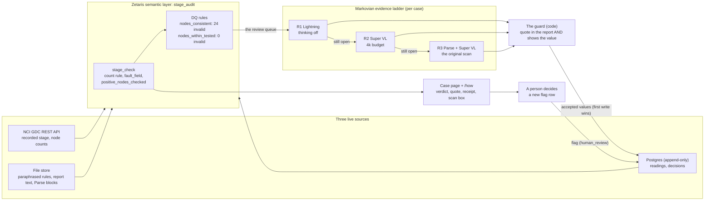

# Architecture

How one record is checked, from the sources to a person's decision. Every arrow that touches a model goes through Meterless Nightshift with a signed receipt, except Nemotron Parse on the scanned pages (NVIDIA direct; Nightshift has no Parse lane).

- **The rule finds the record** (SQL in the layer, no model): the recorded N category and the record's own node count cannot both be true.
- **Nemotron may only quote**: each rung reads one document and never the carryover; Lightning first, Super VL with a thinking budget for what stays open, Parse plus Super VL on the original scan.
- **The guard decides what counts**: a value is accepted only if its verbatim quote is in the document and shows that value.
- **The layer names the field** (`stage_check.fault_field`) and serves the three answers to "how many patients are node-positive?" (`usl demo` step 11).
- **A person decides**: each decision is a new append-only row, and the layer's answer includes it.
- **Off the critical path:** the red-team chain (Super as a Markovian attacker against the guard), the case note (Super, cited facts only), the pre-registered measurements in `docs/evidence/`.
