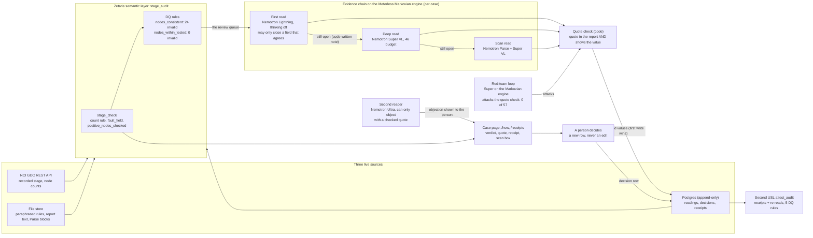

# Architecture

How one record is checked, from the sources to a person's decision. Every arrow that touches a model goes through Meterless Nightshift with a signed receipt, except Nemotron Parse on the scanned pages (NVIDIA direct; Nightshift has no Parse lane). The readers share one state, the Zetaris layer, and three loops run around it: the evidence chain, the red-team loop, and the second reader.

- **The rule finds the record** (SQL in the layer, no model): the recorded N category and the record's own node count cannot both be true.
- **Nemotron may only quote**: each step reads one document and never the carryover. The Markovian engine carries a code-written note of which fields are still open, picks the next step, and stops when nothing is open. Lightning reads first with thinking off, Super VL with a thinking budget reads what stays open, then Parse plus Super VL on the original scan.
- **The quote check decides what counts**: a value is accepted only if its verbatim quote is in the document and shows that value.
- **The layer names the field** (`stage_check.fault_field`) and serves the three answers to "how many patients are node-positive?" (`usl demo` step 11).
- **A person decides**: each decision is a new append-only row, and the layer's answer includes it.
- **The second reader** (Nemotron Ultra, shipped, read-only): it can only object, with a quote the check verifies, and the objection is shown to the person; served from its logged run.
- **The red-team loop**: Super, on the same Markovian engine, attacks the quote check with a code-written ledger of its earlier attempts (0 wrong accepts in 57 judged attacks; 27 of 60 steps repeated an earlier attack despite the ledger).
- **Trust you can check**: every stored value was re-read once with a signed receipt; the receipts and re-reads are a second USL (`attest_audit`) with 5 DQ rules, and `/receipts` checks every signature in the browser.
- **An agent reading the layer**: given its own Zetaris account that can read only the checked values, an agent answered from them (probe 5); Zetaris refused that account everything else.
- Measurements: `docs/results.md` and `docs/evidence/`.
